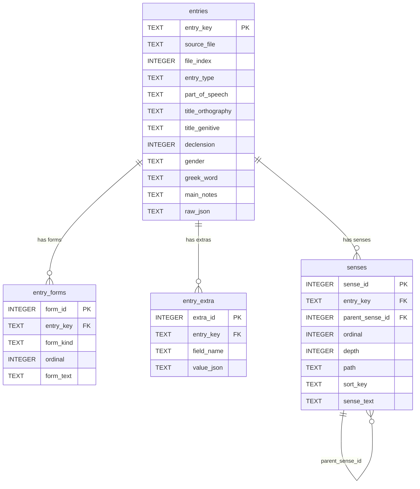
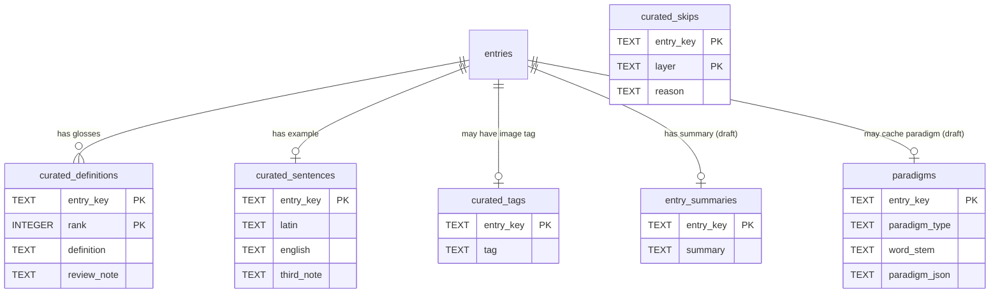

# SQLite schema sketches

**Status: prototype / not frozen.**

These files are a readable picture of the tables `tools/ls_db.py` creates
and `tools/curated_db.py` create, plus two drafted tables nothing builds yet.
They are for looking at — in an editor, a SQL GUI, or a diagram tool — not
a contract the loader is required to follow.

- Prefer evolving the SQL when the product shape changes.
- The live schema is still the Python: `create_schema` in `tools/ls_db.py` and
  `tools/curated_db.py`.
- Do not treat column names, foreign keys, or the draft tables as locked.

```
schema/
  schema.sql              all four L&S tables + indexes, one file
  entries.sql
  entry_forms.sql
  entry_extra.sql
  senses.sql
  curated.sql             curated layer, created by tools/curated_db.py
  draft/                  not created by anything yet
    entry_summaries.sql
    paradigms.sql
    schema.sql            both draft tables, one file
```

Load the live sketch into a throwaway database:

```
sqlite3 /tmp/ls-schema-preview.db < schema/schema.sql
```

`curated.sql` and the draft files assume the L&S tables already exist (they
reference `entries.entry_key`). Load them after `schema.sql`.

## What is live vs drafted

| Table | Status | Source |
| --- | --- | --- |
| `entries` | created by `ls_db.py load` | `ls_*.json` scalars + optional `raw_json` |
| `entry_forms` | created by `ls_db.py load` | `alternative_orthography` / `alternative_genative` |
| `entry_extra` | created by `ls_db.py load` | unrecognised JSON fields (empty today) |
| `senses` | created by `ls_db.py load` | nested `senses` tree, flattened |
| `curated_definitions` | created by `curated_db.py load` | `definitions/<LETTER>.txt` |
| `curated_sentences` | created by `curated_db.py load` | `sentences/<LETTER>.txt` |
| `curated_skips` | created by `curated_db.py load` | `# skip:` lines in both sets of files |
| `curated_tags` | created by `curated_db.py load` | `definitions/tags.txt` |
| `learner_entries` | view, `curated_db.py load` | one flat row per defined word |
| `entry_summaries` | draft | API `summary` field (case governance, etc.) |
| `paradigms` | draft | cached declension / conjugation grids |

## Differences from the live loader

The sketches add a few things the Python DDL does not, because they make the
relationships visible:

- `FOREIGN KEY` clauses (the loader sets `PRAGMA foreign_keys = ON` but does
  not declare the keys)
- `UNIQUE` / `CHECK` hints where the data already behaves that way
- comments on every column

Ids (`form_id`, `extra_id`, `sense_id`) are assigned by the loader, not by
`AUTOINCREMENT`. The sketches keep that: `INTEGER PRIMARY KEY` with no
autoincrement clause.

`raw_json` is included. `load --no-raw` omits that column.

## Entity picture (live tables)



## Entity picture (curated layer and drafts)

The curated tables hang off `entries` the same way. `curated_db.py` builds
them; `entry_summaries` and `paradigms` are still drafts.


